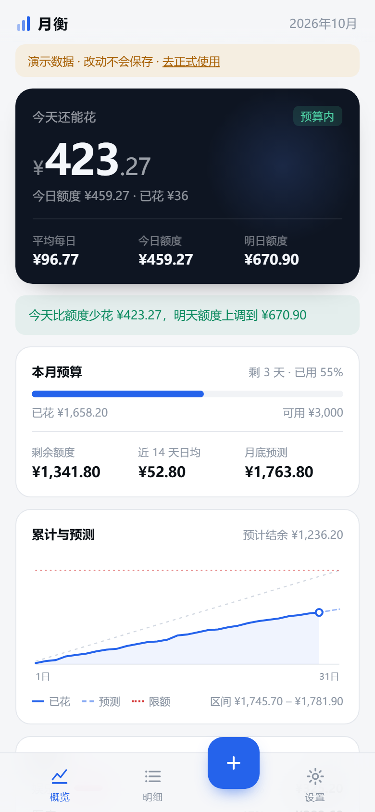
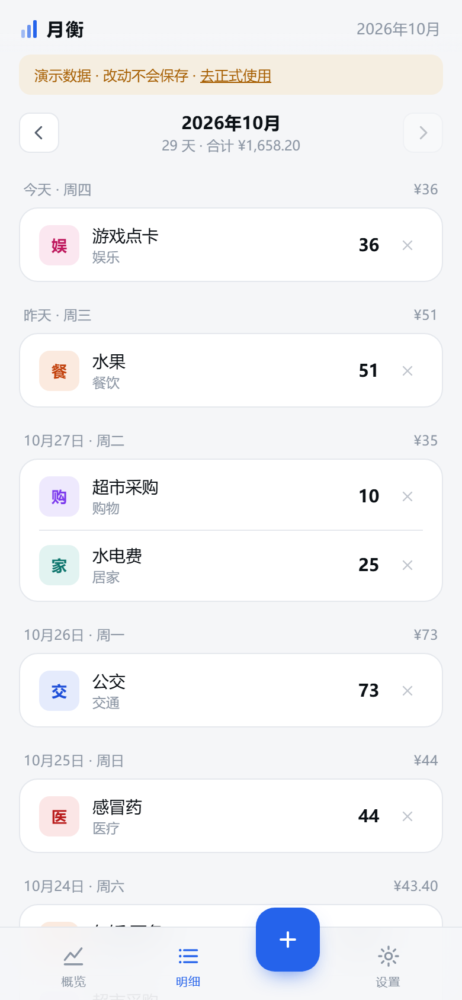
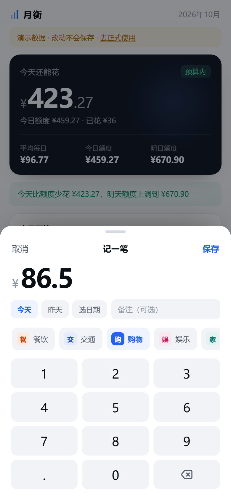
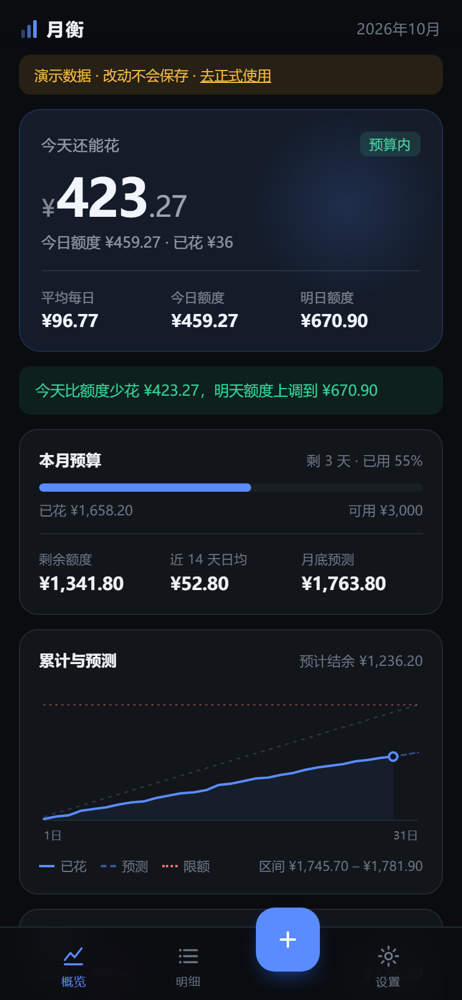

# 月衡 · 消费预测

一个装到手机主屏上的记账 App。记下每天的花销，它会按最近的消费速度推算月底大概花多少，
再按你设的月限额，算出「今天还能花多少」和「明天额度是多少」。



- **不用 Mac、不用开发者账号、不上架**：做成 PWA，用 Safari 添加到主屏幕，图标、全屏、离线都具备。
- **数据只存在本机**：没有账号、没有服务器、没有网络请求。代价是清缓存会丢，所以要偶尔导出备份。
- **零依赖**：纯 HTML/CSS/JS，没有构建步骤，把文件夹丢到任何静态托管上就能用。

| 明细 | 记账 | 设置 |
| --- | --- | --- |
|  |  |  |

跟随系统的深色模式：



---

## 一、装到 iPhone 上（三步）

### 第 1 步：把它放到网上

PWA 需要一个 HTTPS 网址（iOS 只在这种网址下才允许离线缓存和独立安装）。两个免费方案，选一个：

**方案 A：Cloudflare Pages（最省事，推荐）**

1. 浏览器打开 <https://dash.cloudflare.com>，注册/登录（免费）
2. 进 `Workers & Pages` → `Create` → 选 `Pages` → `Upload assets`（有的界面叫 `Direct Upload`）
3. 项目名随便起，比如 `yueheng` → 把这个 `yueheng` 文件夹里的**所有内容**拖进去（不要拖外层文件夹）
4. 点 `Deploy site`，等 30 秒，得到一个 `https://yueheng-xxx.pages.dev` 的网址

**方案 B：GitHub Pages**

1. 在 GitHub 新建一个仓库（Public）
2. `Add file` → `Upload files`，把 `yueheng` 文件夹里的所有内容拖进去 → `Commit changes`
3. 仓库 `Settings` → `Pages` → Source 选 `Deploy from a branch` → 分支 `main`、目录 `/ (root)` → `Save`
4. 等 1 分钟，网址是 `https://你的用户名.github.io/仓库名/`

> 国内访问 github.io / pages.dev 有时偏慢，但只有第一次打开需要联网，之后全部走本地缓存。

### 第 2 步：用 Safari 打开那个网址

必须用 **Safari**。微信内置浏览器、Chrome for iOS 都不能「添加到主屏幕」。

### 第 3 步：添加到主屏幕

Safari 底部「分享」按钮 → 往下找「添加到主屏幕」→ 添加。

回到桌面，就有了「月衡」的图标。点开是全屏的，没有地址栏，断网也能记账、也能看预测。

---

## 二、日常怎么用

| 场景 | 操作 |
| --- | --- |
| 第一次用 | 点概览页的「设置月限额」，填这个月打算花多少 |
| 花了钱 | 点底部中间的 **+**，按数字键盘输金额，选分类，保存 |
| 看今天还能花多少 | 概览页最上面的大数字 |
| 看月底会花多少 | 「累计与预测」卡片，含波动区间 |
| 看每天配额怎么变 | 概览页第二行会提示「明天的额度上调/下调到多少」 |
| 记错了 | 明细页点那一行右边的 ✕ |

补记前几天的账：记账面板里点「昨天」或「选日期」（不能选未来）。

---

## 三、额度和预测是怎么算的

先把三个数分清楚，这是整个 App 的口径：

| 指标 | 公式 | 含义 |
| --- | --- | --- |
| 平均每日 | 月限额 ÷ 当月天数 | 纯平摊参考，看看「每天花多少才撑到月底」 |
| 今日额度 | (月限额 − **今天之前**的支出) ÷ 剩余天数 | 今天这一天的配额，**在你花今天第一笔钱之前就固定了** |
| 今天还能花 | 今日额度 − 今天已花 | 负数就是超支 |
| 明日额度 | (月限额 − 累计已花) ÷ 今天之后的天数 | 明天重新摊一次 |

举例：限额 150，今天 29 号（本月还剩 3 天），今天花了 50

- 平均每日 = 150 ÷ 31 = **¥4.84**
- 今日额度 = (150 − 0) ÷ 3 = **¥50**
- 今天还能花 = 50 − 50 = **¥0**（花 60 就是 −¥10）
- 明日额度 = (150 − 50) ÷ 2 = **¥50**（花 60 会降到 ¥45）

关键点：**今天的额度不会被今天的消费倒扣**。超支只影响「今天还能花」和「明天额度」，
这样额度才追得上、也才有意义。今天省下的钱会摊到后面几天（额度上调），今天超支则会挤占后面的额度（下调）。

**月底预测**

```
预测 = 已花 + 最近 N 天日均 × 剩余天数
```

- N 默认 14 天，可在设置里改成 7 天、14 天或整月。
- 只统计**从第一笔记录开始**的天数，不会把「还没开始记账」的空白天当成没花钱。
- 月初记录少于 3 天时，日均会向「平均每日」略微靠拢，防止一笔大额把预测带飞。
- 波动区间按日花销的标准差展开，反映的是「花得不规律」的程度。

**超支结转**

月底结算时如果还欠着（已花 > 可用额度），欠的部分自动扣到下个月：

```
本月可用 = 月限额 + 上月结转（负数）
```

只结转欠款，结余不清零也不累积。连续超支会叠加（8 月欠 100、9 月再欠 50 → 10 月可用 = 限额 − 150）。
中间有整月没有记录时停止回溯，视为没有欠款。可以在设置里关掉。

**图表**：蓝色实线是已花的累计曲线，蓝色虚线是按当前速度的预测，灰色虚线是「按额度均匀花」的理想节奏，红色点线是可用额度。

---

## 四、数据

- 全部存在浏览器的 `localStorage` 里，键名 `yueheng.state.v1`。**不会上传到任何地方。**
- 设置页可以「导出备份」（JSON 文件）或「复制全部数据」（粘到备忘录里）。
- **会丢的情况**：卸载主屏图标、Safari 设置里清除网站数据、系统长期不用后清理存储。所以建议每月导出一次。
- **换手机**：旧手机导出 → 存到「文件」App 或 iCloud → 新手机导入备份。

---

## 五、更新版本

改完代码后重新上传覆盖（Cloudflare Pages 重新 Deploy、或 GitHub 重新提交），
手机上把 App 从后台划掉再打开两次，新版本就会生效（Service Worker 会自动换掉旧缓存）。

如果改了 `css/` 或 `js/` 里的文件想让所有设备立刻更新，可以把 `sw.js` 里的
`CACHE = 'yueheng-v2'` 改成 `v3`、`v4`。

---

## 六、本地开发

无构建、无依赖，改完刷新就行。

```
yueheng/
├── index.html            页面骨架
├── manifest.webmanifest  PWA 清单（名字、图标、启动方式）
├── sw.js                 Service Worker（离线缓存）
├── css/app.css           全部样式
├── js/finance.js         计算核心：预测、日均建议（纯函数，可单测）
├── js/store.js           数据层：读写 localStorage、导入导出
├── js/app.js             界面逻辑：三个页面 + 记账面板 + 图表
├── icons/                图标（tools/make_icons.py 生成）
├── preview/              预览截图
└── tools/
    ├── test-finance.cjs  计算逻辑测试
    ├── shot.mjs          用 Chrome 截图（调试排版用）
    └── make_icons.py     重新生成图标
```

本地跑模拟器不需要，直接起个静态服务器即可（二选一）：

```powershell
python -m http.server 8087 --directory .
# 或者（有 Node 的话）
npx serve .
```

然后浏览器打开 `http://127.0.0.1:8087/`。

想先看效果、不想到处点：在网址后面加 `?demo=1` 会用一份演示数据渲染（不写入你的本地数据）。

跑测试：

```powershell
node tools/test-finance.cjs
```

---

## 七、已知限制

- **只能手动记账**。iOS 的 PWA 读不到银行、支付宝、微信的账单，也不能后台自动同步。
- **没有推送提醒**。iOS 对 PWA 的推送支持有限，且需要额外服务端。
- **数据可能被系统清掉**，所以一定要定期导出备份。
- **结转按当前限额回算历史**：改月限额会连带改变上个月的「超支」判断，进而影响本月结转。
- 只支持人民币和中文界面（`js/app.js` 里搜 `¥` 可以改）。

如果哪天需要「桌面常驻 + 推送提醒 + 数据更稳」，那就要走原生路线：$99/年 的 Apple 开发者账号 + 云端 macOS 构建。
这份代码的计算逻辑（`js/finance.js`）是独立纯函数，可以直接搬到 Swift 或 React Native 里复用。
